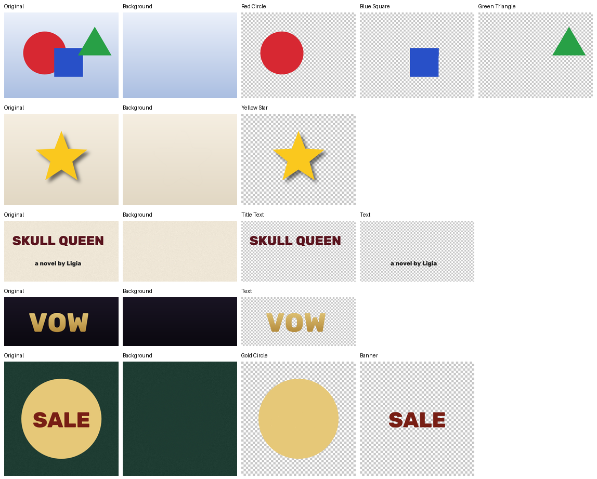

# Unflatten

**One image. Every layer.** A Photoshop plugin that turns a flattened image into individually named, transparent, editable layers, plus a reconstructed background and the original kept as a hidden backup. Everything runs on your computer.



## Layout

```
unflatten/
  plugin/            Photoshop UXP panel (one button)
  engine/            local separation engine (Python + ONNX)
    unflatten_engine/  pipeline, stages/, server, PSD writer, CLI
    tests/             acceptance tests on ground-truth scenes
    download_models.py fetch OWLv2, SAM 2.1, LaMa, CLIP (≈ 1.6 GB, permissive licences)
  ARCHITECTURE.md    decisions, limits, costs, acceptance criteria, plan
```

## Run it

```bash
cd unflatten/engine
pip install -r requirements.txt
python download_models.py          # optional: graphics work without models
python -m unflatten_engine.server  # leave running; listens on 127.0.0.1:7865 only
```

In Photoshop 2023 (24.1) or later:

1. Open the **UXP Developer Tool** and choose **Add Plugin**. Select `unflatten/plugin/manifest.json`, then click **Load**.
2. Open an 8-bit RGB image and choose **Plugins ▸ Unflatten**.
3. Click **Unflatten**.

The new layers appear above your original, which is hidden as `Original (flattened)`. One **Undo** reverts everything.

If the panel reports it can't reach the engine even though the server is running, your UXP version may be rejecting the localhost permission. Change `"domains"` in `plugin/manifest.json` to `"all"` and reload the plugin.

### Without Photoshop

```bash
python -m unflatten_engine cover.png -o cover_layers/
```

This writes `cover_layers/cover.psd` (a real layered PSD), one PNG per layer, and `report.json` with timings and reconstruction quality.

### Tests

```bash
cd unflatten/engine && python -m pytest -q          # 37 synthetic-scene tests (fast)
python -m pytest -q -m real                          # acceptance A-D on real images (downloads them, ~6 min on CPU)
node ../plugin/test/harness.js <raw.rgb> <w> <h>     # panel script vs a running engine
```
